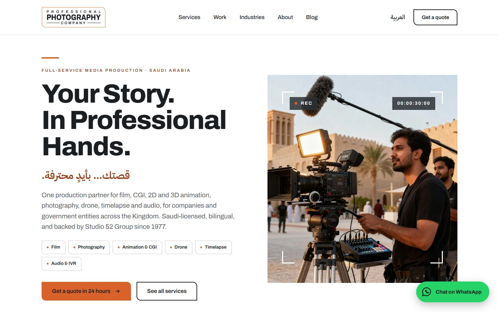
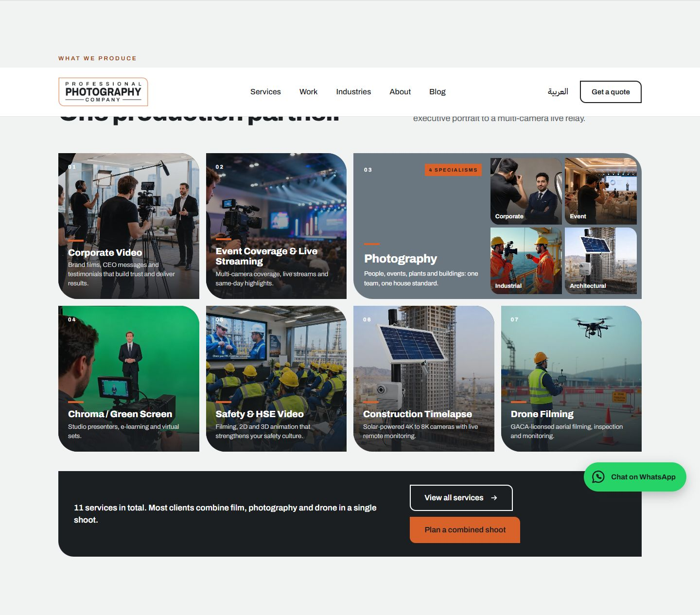
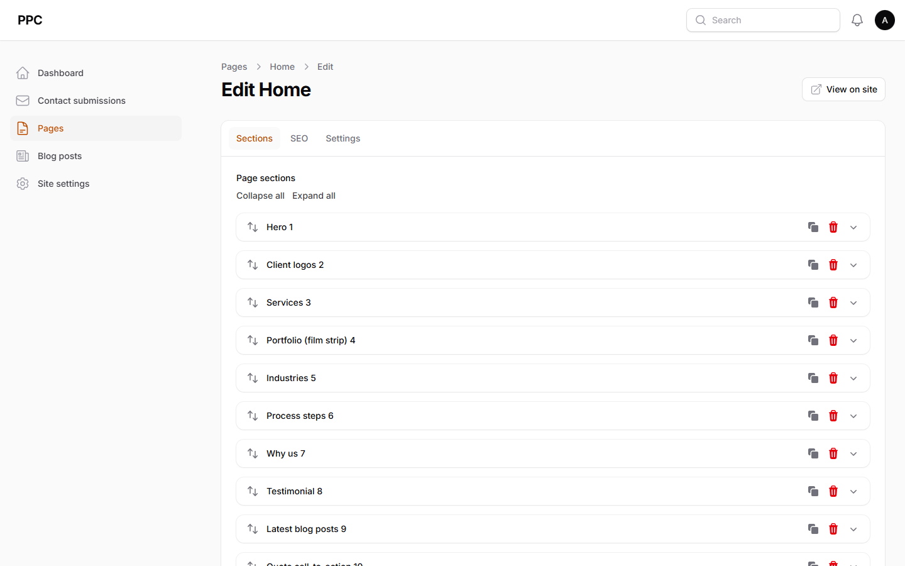

# PPC Landing Page

Landing page, admin panel and CRM-ready contact form for **Professional Photography Company** (a Studio 52 Group company), built with Laravel 12, Filament 5 and Tailwind CSS 4.

Take-home assignment for the Full Stack Laravel & PHP Developer role at Studio 52 Media and Technology Group.

## The three requirements

| Requirement | Where |
|---|---|
| Fully responsive, mobile-friendly landing page | Home page built from the reference design, checked in Chrome at phone (390 px) and desktop (1440 px) widths: hamburger menu, stacked columns, fluid headings, no horizontal scroll |
| Admin panel to manage all page elements: content, images, videos, SEO (meta title, description, canonical URL…) | `/admin` → **Pages**: every section is an editable, reorderable block; **SEO** tab per page and per blog post; hero video (MP4) and showreel link; **Site settings** for logo, contact details and footer |
| Contact form on the Contact Us page, integrated with the CRM, submissions stored and visible in the admin | `/contact` → saved first, then sent to the CRM by a queued job with retries; **Contact submissions** in the admin with CRM status, retry button, filters and CSV/XLSX export |

## Screenshots

| Desktop | Phone |
|---|---|
|  |  |





## Quick start

Requirements: PHP 8.2+, Composer, Node 20+, and MySQL 8 or SQLite.

```bash
git clone https://github.com/SiddharthRathod/ppc-landing-laravel.git
cd ppc-landing-laravel

composer run setup        # composer install, .env, app key, migrations, npm install + build
php artisan db:seed       # demo admin, design content, 3 blog guides
php artisan storage:link  # serves uploaded images from /storage
```

`.env.example` uses SQLite, so it works without a database server. For MySQL, set `DB_CONNECTION=mysql` and the `DB_*` values in `.env` before running the commands.

Then run the site and the queue worker (two terminals):

```bash
php artisan serve         # http://127.0.0.1:8000
php artisan queue:work    # sends contact submissions to the CRM and builds exports
```

Or everything in one terminal: `composer run dev` (server, queue, logs and Vite).

> `APP_URL` in `.env` must be the address you open in the browser (default `http://127.0.0.1:8000`). Uploaded images and canonical URLs are built from it; if it differs, image previews in the admin will not load.

### Demo login

| URL | Email | Password |
|---|---|---|
| http://127.0.0.1:8000/admin | `admin@ppc.test` | `123456789` |

The email is pre-filled on the login page in the local environment. Change it with `ADMIN_EMAIL` / `ADMIN_PASSWORD` in `.env` and run `php artisan db:seed --class=AdminUserSeeder`.

## Admin panel

| Menu | What it manages |
|---|---|
| **Contact submissions** | Every enquiry from the form (read-only). CRM status badge (pending, sent, failed, skipped), **Retry CRM** button, filters, soft delete and restore, CSV/XLSX export |
| **Pages** | Home and Contact Us. **Sections** tab: 11 block types (hero with stats and video, client logos, services, portfolio film strip, industries, process, why us, testimonial, latest posts, quote call-to-action, contact form). Add, edit, reorder, duplicate or remove sections. **SEO** tab: meta title, description, canonical URL, social sharing image, robots |
| **Blog posts** | Guides with rich-text body, card image, category, publish date (empty = draft, future = scheduled) and SEO fields |
| **Site settings** | Logos, phone, email, WhatsApp number, footer tagline (English and Arabic), footer link columns, cities, social links, CR and VAT numbers |

## How it works

**Pages as blocks.** Each page stores its sections in a JSON `content` column, edited with Filament's Builder. Each block type has a class in `app/Filament/Blocks/` (its fields) and a Blade partial in `resources/views/sections/` (its markup). `PageController` loads the page and renders the sections in the order set in the admin. A new section type is one block class plus one partial.

**Contact form and CRM.**

```
Form → StoreContactRequest (validation, honeypot, phone rule, 5 per minute per IP)
     → ContactSubmissionService: save to contact_submissions, then queue SendSubmissionToCrm
     → SendSubmissionToCrm: 3 tries (wait 1 min, then 5 min) → status "sent", or "failed" with the error
```

Submissions are always saved before the CRM is called, so a CRM outage never loses a lead; failed ones can be retried from the admin. The CRM sits behind the `App\Contracts\CrmClient` interface. The default `LogCrmClient` writes each lead to the log; connecting the real CRM (HubSpot, Zoho, Salesforce…) means one new class and one line in `AppServiceProvider`, selected with `CRM_DRIVER` in `.env`. `CRM_ENABLED=false` saves submissions as "skipped" without sending.

**SEO.** One Blade component (`<x-seo>`) renders the title, description, robots, canonical, Open Graph and Twitter tags from each page's or post's SEO fields, with fallbacks (hero photo or post image as the sharing image). The home page has Organization JSON-LD built from Site settings. `/sitemap.xml` lists published pages and posts only; `/robots.txt` blocks `/admin` in production and the whole site everywhere else, so staging copies are never indexed.

**SEO breadcrumbs.** `App\Services\BreadcrumbService` builds the trail automatically from the current route and its bound model (Contact: Home › Contact Us; Blog: Home › Blog; post: Home › Blog › post title), so no page sets breadcrumbs by hand. A view composer passes it to the layout, which renders the `<x-breadcrumbs>` component (`<nav aria-label="Breadcrumb">`, current page as `aria-current="page"` without a link, horizontal scroll on phones) and a schema.org **BreadcrumbList** JSON-LD from the same trail. URLs come from `route()`, like the canonical tag, so they are absolute and the last item always equals the page's canonical URL. Each page has one trail, de-duplicated by URL. No breadcrumbs on the home page, on 404s or on unknown routes. New page types are one line in the service.

**Images and video.** Uploads go to the `public` disk. Below-the-fold images load lazily; the hero image loads first (`fetchpriority="high"`). The hero video is an uploaded MP4 that plays muted and looped over the photo, which stays as the poster while it loads.

**Code style.** Thin controllers, Form Requests for validation, a service for business logic, a queued job for the external call, enums for statuses (`CrmStatus`, `PostStatus`) and Eloquent casts.

## Tests

```bash
php artisan test
```

109 tests: contact form validation and storage, breadcrumbs and BreadcrumbList, the CRM job (success, retry, failure, no double send), every admin screen (Filament/Livewire tests), page rendering from blocks, HTML escaping, blog visibility rules, SEO tags, JSON-LD, sitemap and robots.txt, and a unit test for the phone number rule. Tests use an in-memory SQLite database and fake the queue and file storage.

## Lighthouse

Home page, Lighthouse 12 in Chrome, measured locally with `APP_ENV=production`:

| | Performance | Accessibility | Best Practices | SEO |
|---|---|---|---|---|
| Desktop | 99 | 100 | 100 | 100 |
| Mobile | 84 | 100 | 100 | 100 |

Mobile performance was measured on `php artisan serve`, which has no gzip compression or caching; a real web server adds both. Layout shift is 0.

## Deploying

- `APP_ENV=production`, `APP_DEBUG=false` and `APP_URL=https://your-domain` (canonical URLs and the sitemap use it; robots.txt only allows indexing in production).
- `php artisan storage:link`, then `php artisan config:cache route:cache view:cache`.
- Keep `php artisan queue:work` running with Supervisor (or the host's equivalent), otherwise submissions stay "pending".
- Use a real admin email and a strong password (`ADMIN_EMAIL`, `ADMIN_PASSWORD`).

## Notes and open points

- **Design and images:** the layout follows the reference design (desktop only); the mobile layout was designed to match it. Photos and client logos come from the reference and are placeholders until real assets arrive. All text and images are editable in the admin.
- **CRM:** not named yet, so it is behind the interface above.
- **Arabic:** Arabic lines from the design are included and editable; a full Arabic (RTL) version is not in scope until confirmed.
- **Contact Us page:** not in the reference design, so it was designed in the same style.
- **Blog pages** (`/blog`, `/blog/{slug}`) were added so the home page guide cards have somewhere to link to.
- **Accessibility:** two colours were adjusted to pass WCAG AA contrast: the dark orange used for small labels (`#A9461A` → `#9A3F17`) and the text on the WhatsApp button (dark instead of white on WhatsApp green).
